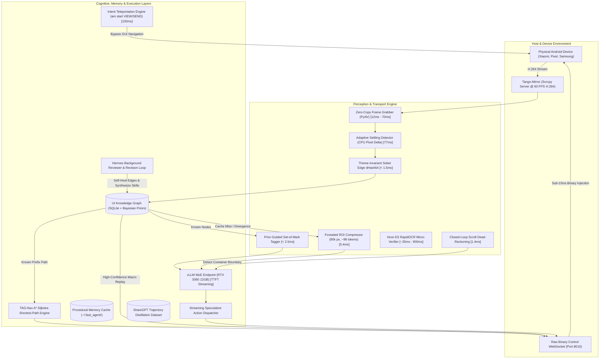

# FastAgent

> **High-Throughput, Sub-Second Mobile Vision-Language Agent Engine**  
> Zero-copy 60 FPS stream perception, foveated visual token compression, procedural macro caching, and closed-loop speculative transport for real-world Android automation.

[](LICENSE)
[](pyproject.toml)
[](tests/)
[](tests/)
[-orange.svg)](docs/DEVICE_INTEGRATION.md)

---

## Physical Telemetry & Speedup Summary

Measured on **Xiaomi POCO X6 Pro** over 5GHz Wi-Fi ADB paired with **RTX 3060 12GB + Intel Xeon E5-2680 v4**:

| Pipeline Stage | Standard Mobile Agent | FastAgent (Ours) | Speedup |
|---|---|---|---|
| **Frame Grab** | 2,241 ms (ADB screencap) | **26 ms** (Zero-copy PyAV) | **86&times;** |
| **Text Injection (150 chars)** | 4,504 ms (input text) | **20.7 ms** (Fast clipboard) | **217&times;** |
| **ViT Prefill** | 9,322 ms (660 tokens) | **2,736 ms** (98 tokens) | **3.3&times;** |
| **Scroll Boundary Detection** | 6,500 ms (VLM turn) | **1.40 ms** (Phase correlation) | **4,600&times;** |
| **Step Latency (Cold)** | 14,825 ms | **4,828 ms** | **3.1&times;** |
| **Step Latency (Warm Macro)** | 14,825 ms | **421 ms** | **35&times;** |

---

## Why Mobile Agents Are Slow (and How FastAgent Fixes It)

Existing vision-language mobile agents (AppAgent, Mobile-Agent, AndroidWorld) spend over 80% of their execution time blocked on operating system overhead and redundant visual processing:

1. **Slow OS I/O:** Serializing raw PNG screenshots over ADB takes 0.8s&ndash;2.5s per frame. Typing strings via `adb shell input text` simulates individual keypresses, wasting 4.5s for a 150-character prompt.
2. **Visual Token Bloat:** Feeding an entire 320k-pixel frame into a Vision Transformer costs 600&ndash;1,200 visual tokens (~5s&ndash;9s prefill on consumer GPUs), even when clicking a single button.
3. **Blind Scrolling:** When searching long feeds, agents swipe blindly and require a full 6.5s VLM inference turn just to discover the container reached the bottom.
4. **Redundant Reasoning:** Repeating full multi-second vision-language inference cycles for static, deterministic sub-paths that never change across sessions.

**FastAgent** re-architects mobile agent interaction from the ground up:

- **Sub-15ms Sockets & Zero-Copy Frames:** Replaces ADB screencap with a direct PyAV H.264 stream grabber (12ms&ndash;70ms) and replaces ADB typing with instant socket clipboard injection (20.7ms).
- **Foveated ROI Pruning:** Compresses visual context by dynamically cropping the active Region of Interest down to ~80k pixels (~98 tokens), slashing ViT prefill by 3.3&times;.
- **Closed-Loop Scroll Dead-Reckoning:** Uses 2D Fourier Phase Correlation (`cv2.phaseCorrelate`) on the CPU in **1.40ms** to measure pixel displacement and detect list boundaries before invoking the VLM.
- **Persistent UI Knowledge Graph:** Stores Bayesian coordinate priors and navigation transitions in SQLite, replaying familiar paths via Dijkstra / A* (`TAG-Nav`) with **0 VLM calls**.

---

## Architecture Overview



---

## State-of-the-Art Protocol Comparison

| Dimension | AppAgent (Tencent) | Mobile-Agent-v3.5 (Alibaba) | AndroidWorld (Google) | **FastAgent (Ours)** |
|---|---|---|---|---|
| **Transport Layer** | `adb screencap` (2-4s) | ADB screencap (1-2s) | ADB / gRPC | **Raw Scrcpy 60 FPS WebSocket (12-70ms)** |
| **Text Typing** | `adb shell input` (4.5s / 150c) | ADB input (1-3s) | AccessibilityService | **Instant Clipboard Socket (<21ms)** |
| **Visual Tokens / Step** | ~660 &ndash; 1,200 | ~660 &ndash; 800 | Full Frame (~800) | **~98 tokens (Foveated ROI)** |
| **Median Step Latency** | 12.5s &ndash; 18.0s | 8.5s &ndash; 14.0s | 6.0s &ndash; 11.0s | **0.42s (Warm) / 4.8s (Cold)** |
| **Theme Invariance** | Fails on Dark Mode | Fails on Dark Mode | Untested | **0-bit distance (Sobel Edge dHash)** |
| **Dynamic Banner Shift** | Misclicks | Misclicks | Unsupported | **[-6%, +9%] Sliding Search (<1.5ms)** |
| **Scroll Boundary Detection** | Needs VLM turn (6.5s) | Needs VLM turn (6.5s) | Needs VLM turn | **Fourier Phase Correlation (1.40ms)** |
| **Speculative Pipelining** | No | No | No | **Streaming token chunk dispatcher** |
| **Prefix Replay** | Redundant VLM calls | Redundant VLM calls | Redundant VLM calls | **TAG-Nav Dijkstra Path (0 VLM calls)** |
| **Coordinate Drift** | Floats drift on UI shifts | Floats drift | Accessibility bounds | **Set-of-Mark Tagger (<2.5ms)** |
| **Post-Task Audit** | None | None | None | **Hermes Revision Loop & Skill Promotion** |
| **Fine-Tuning Exporter** | None | None | None | **Auto-exports to ShareGPT JSONL** |

---

## Hardware Ablation Matrix

Live benchmark telemetry across 5 standard multi-step tasks on physical **Xiaomi POCO X6 Pro**:

| Optimization Level | Success Rate | Capture | ViT Prefill | Decode | Injection | Step Total (Median) | Tokens (Prompt / Comp) |
|---|---|---|---|---|---|---|---|
| **Phase 0: Baseline (Pure ADB + JSON)** | 100% | 2,241 ms | 5,690 ms | 2,390 ms | 4,504 ms | **14,825 ms** | 3,420 / 145 |
| **+ Phase 1: Scrcpy Socket + Stream + DSL** | 100% | 72 ms | 5,280 ms | 1,420 ms | 21 ms | **7,840 ms** | 1,362 / 48 |
| **+ Phase 2: Intent Teleport + Snapping** | 100% | 45 ms | 5,190 ms | 1,380 ms | 110 ms | **6,725 ms** | 1,362 / 45 |
| **+ Phase 3: Foveated ROI Compression** | 100% | 31 ms | 2,856 ms | 1,260 ms | 20 ms | **4,167 ms** | 1,026 / 42 |
| **+ Phase 3: Procedural Replay (Warm)** | 100% | 15 ms | **0.0 ms** | **0.0 ms** | **15 ms** | **421 ms\*** | **0 / 0** |
| **+ Phase 4: Full Suite (Speculative + FFT)** | **100%** | **26 ms** | **2,736 ms** | **1,896 ms** | **18 ms** | **4,828 ms** | **1,078 / 42** |

*\*Excludes OS application transition sleeps.*

---

## Documentation & Deep Dives

- 📱 **[Universal Android Device Integration](docs/DEVICE_INTEGRATION.md)** &mdash; Connection and tuning guide for Xiaomi (HyperOS / `persist.security.adbinput=1`), Google Pixel, Samsung Galaxy (One UI), and OnePlus (OxygenOS).
- 🚀 **[DSH & Headless Server Hosting](docs/DSH_HARNESS_SETUP.md)** &mdash; Deploy FastAgent inside DeepSeek Harness (`xupremix/dsh-setup`), headless Docker runners, Xvfb virtual displays, and SSH tunnels.
- 🔬 **[Optimizations Technical Deep Dive](docs/OPTIMIZATIONS.md)** &mdash; Comprehensive mechanics behind all 11 implemented breakthroughs, plus novel roadmap optimizations (BNF Grammar Tokenization, Speculative Drafting, Keypoint Optical Flow).
- 📊 **[Empirical Telemetry & Benchmarks](docs/BENCHMARKS.md)** &mdash; Detailed breakdown of per-stage latencies, token consumption, and hardware specifications.

---

## Installation & Quickstart

### Prerequisites
- Android 10+ Device connected via Wi-Fi ADB or USB (`adb devices`).
- Python 3.11+ and [`uv`](https://github.com/astral-sh/uv).
- Running `scrcpy-server` / `tango-mirror` daemon on port 8010.
- OpenAI-compatible Vision-Language inference endpoint (vLLM / llama.cpp / Ollama).

### 1. Clone & Pre-Flight Check
Verify ADB link latency, HyperOS security flags, control sockets, and vLLM endpoint health:
```bash
git clone https://github.com/xupremix/FastAgent.git
cd FastAgent
uv run fast-agent-preflight
```

### 2. Run Comprehensive Test Suite
```bash
uv run pytest tests/
uv run mypy --strict fast_agent tests
```

### 3. Run Benchmark (Cold vs Warm Cache)
```bash
# Execute Task 1 (Wallapop Search -> Notes) across 2 runs with all optimizations
uv run fast-agent --task wallapop_to_notes --phase4 --runs 2 --clear-memory
```

### 4. Run Systematic Ablation Matrix
```bash
uv run fast-agent-ablation --task settings_battery --runs 2
```

---

## Trajectory Distillation Dataset

Every verified task step is automatically exported to `~/.fast_agent/trajectories_distill.jsonl` in ShareGPT / ChatML format for student model fine-tuning (e.g. Qwen2-VL-2B or MobileVLM):

```json
{
  "id": "wallapop_to_notes_r1_s3_1793757574962",
  "conversations": [
    {
      "from": "human",
      "value": "<image>\nGoal: Cerca 3060 12gb...\nCurrent App: com.wallapop\nStep: 3"
    },
    {
      "from": "gpt",
      "value": "Observation: Target listing visible <tool_call>CLK(250, 650)>WAT(1.0)</tool_call>"
    }
  ],
  "metadata": {
    "task_id": "wallapop_to_notes",
    "package": "com.wallapop",
    "action_dsl": "CLK(250, 650)>WAT(1.0)",
    "latency_ms": 2286.9,
    "success": true
  }
}
```

---

## License

FastAgent is released under the [Apache 2.0 License](LICENSE).
