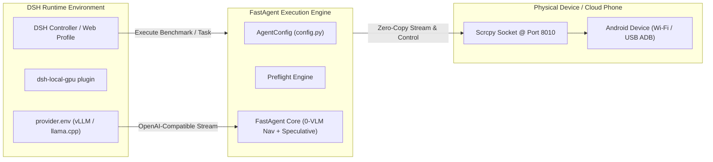

# Hosting & Harness Integration Guide (DSH & Headless Servers)

This guide documents how to host, containerize, and integrate **FastAgent** within headless execution environments, continuous testing pipelines, and remote agent harnesses like **DSH** (`xupremix/dsh-setup`).

---

## 1. DSH (Developer Server Harness) Integration

DSH provides isolated profile management, local GPU offloading, and provider endpoint configuration for autonomous agent operations.

### Integration Architecture



### Setup Steps in DSH

1. **Clone and Install FastAgent alongside DSH:**
   ```bash
   git clone https://github.com/xupremix/FastAgent.git "$HOME/FastAgent"
   cd "$HOME/FastAgent"
   uv sync --extra dev
   ```

2. **Configure Provider Endpoint:**
   FastAgent automatically reads the inference endpoint from DSH's local provider configuration or environment variables:
   ```bash
   # Source DSH provider configuration
   if [ -f "$HOME/.config/dsh-local-gpu/provider.env" ]; then
       source "$HOME/.config/dsh-local-gpu/provider.env"
   fi

   export VLLM_BASE_URL="${OPENAI_BASE_URL:-http://127.0.0.1:8000/v1}"
   export VLLM_API_KEY="${OPENAI_API_KEY:-sk-strata}"
   ```

3. **Register FastAgent as a DSH Automation Skill:**
   Add FastAgent execution to your DSH harness scripts or profile tasks:
   ```bash
   # Execute a multi-step task through FastAgent
   uv --directory "$HOME/FastAgent" run fast-agent --task wallapop_to_notes --phase4
   ```

---

## 2. Headless Server & CI Deployment (Docker / Cloud Runner)

In containerized or cloud environments (e.g. AWS EC2, GCP Compute Engine, GitHub Actions runners), physical displays are unavailable. FastAgent supports fully headless operation via virtual framebuffers and remote ADB tunnels.

### Headless Scrcpy via Xvfb

```bash
# Install virtual framebuffer and codec packages
sudo apt-get update && sudo apt-get install -y xvfb ffmpeg libavcodec-dev libavformat-dev

# Launch virtual display and headless Scrcpy server
Xvfb :99 -screen 0 1280x1024x24 &
export DISPLAY=:99

# Start Scrcpy daemon forwarding video to port 8010
scrcpy --tcpip=192.168.10.108:5555 --no-playback --video-codec=h264 --port=8010 &
```

### Docker Containerfile

```dockerfile
FROM python:3.12-slim

RUN apt-get update && apt-get install -y \
    android-tools-adb \
    ffmpeg \
    libgl1 \
    libglib2.0-0 \
    curl \
    git \
    && rm -rf /var/lib/apt/lists/*

# Install uv package manager
COPY --from=ghcr.io/astral-sh/uv:latest /uv /bin/uv

WORKDIR /app
COPY pyproject.toml README.md LICENSE ./
COPY fast_agent ./fast_agent
COPY tests ./tests

RUN uv sync --extra dev

ENV PYTHONPATH=/app
ENV VLLM_BASE_URL=http://host.docker.internal:8000/v1

ENTRYPOINT ["uv", "run", "fast-agent"]
```

---

## 3. Remote Network ADB Forwarding (SSH Tunneling)

If the Android device is attached to a remote home workstation or office router while the agent runs in a cloud data center:

```bash
# Reverse tunnel Scrcpy video stream (8010) and ADB control (5555)
ssh -R 5555:localhost:5555 -R 8010:localhost:8010 user@cloud-agent-server

# On the cloud runner:
adb connect 127.0.0.1:5555
uv run fast-agent-preflight
```
